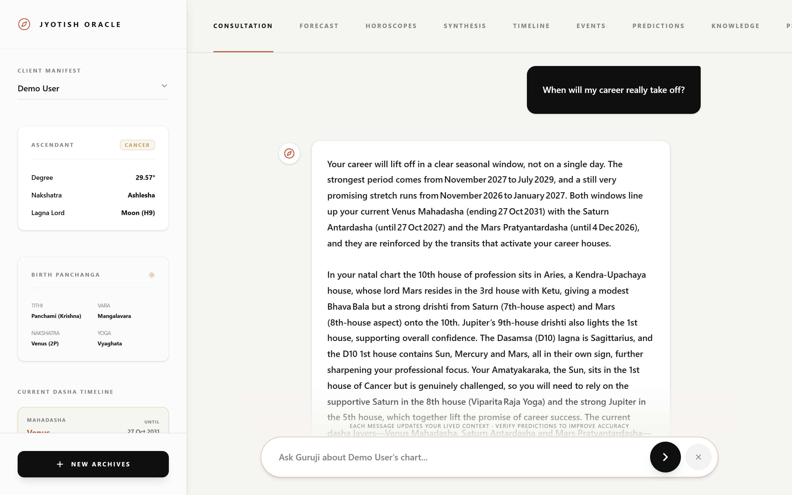
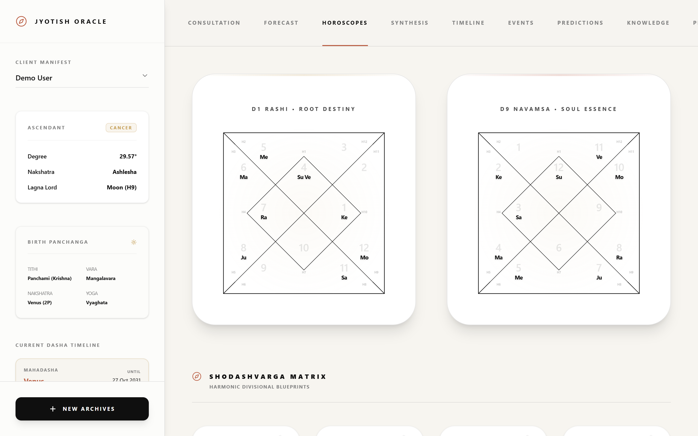
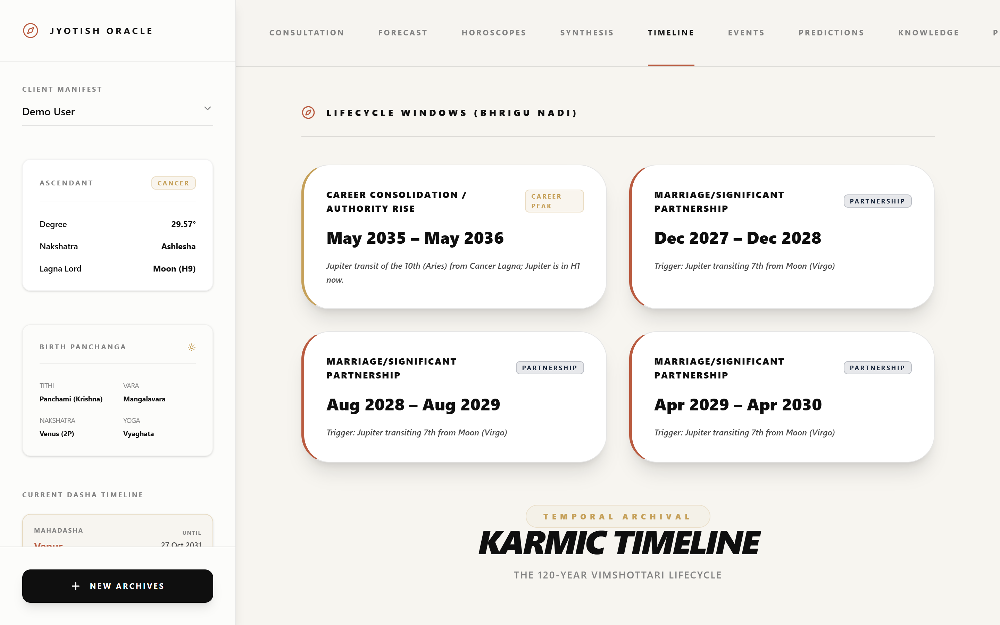
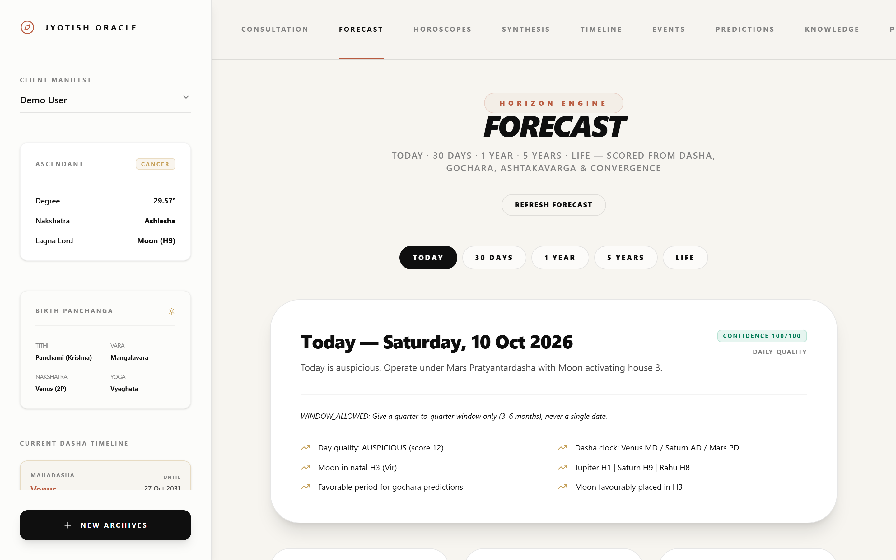
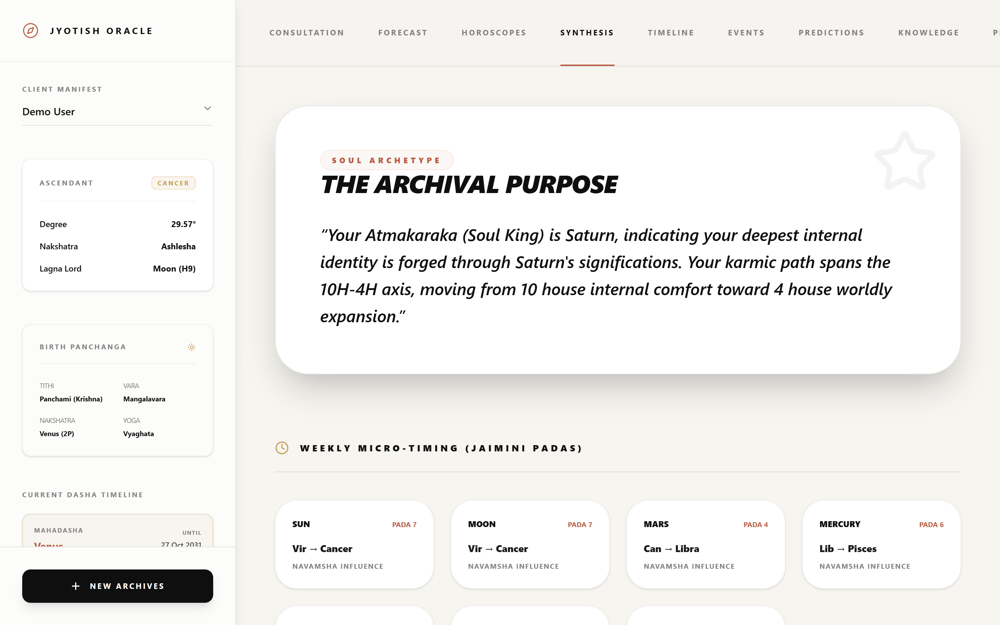
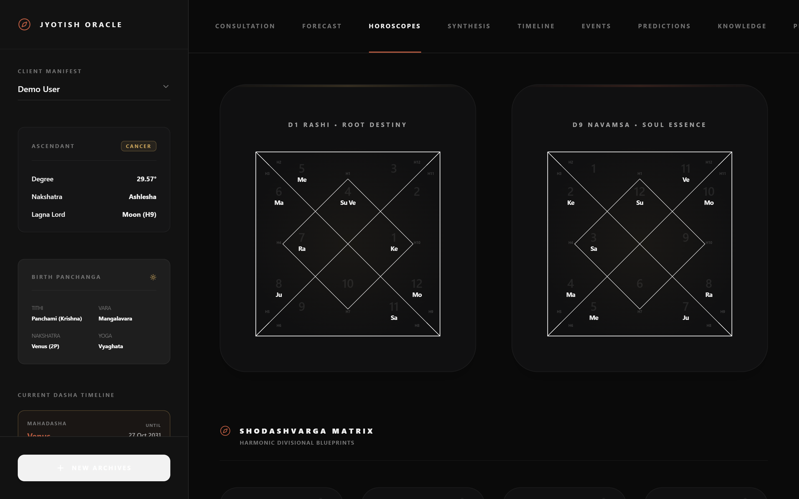
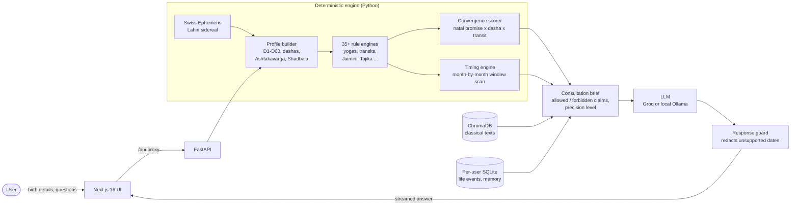
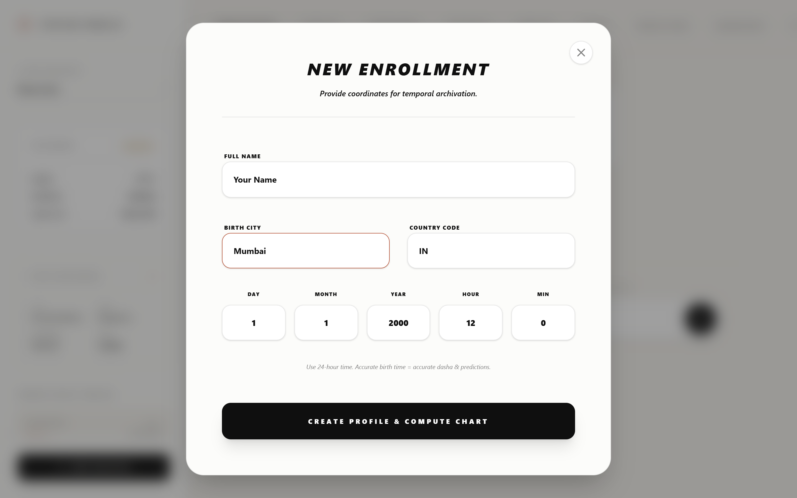

<div align="center">

# Astro.AI — Jyotish Oracle

**A grounded AI system: a deterministic Vedic-astrology engine computes the facts, and the LLM is only allowed to explain them.**




</div>

## Why this project exists

Ask a general chatbot "when will my career take off?" and it will invent a confident answer. Astro.AI is built to make that impossible.

Every answer goes through a pipeline in which **code, not the model, decides what is true**:

1. **Swiss Ephemeris** computes the exact sky at birth: planets, houses, nakshatras, 16 divisional charts, dashas, Ashtakavarga and Shadbala.
2. **35+ rule engines** turn that chart into scored, explainable evidence: yogas, transits, convergence and month-by-month timing windows.
3. **A consultation brief** lists what the AI is *allowed* to claim, what it is *forbidden* to claim, and how precise it may be.
4. **The LLM** writes the reply from that brief only, and **a response guard** strips unsupported dates before the user sees them.

The domain is astrology; the pattern, an *LLM grounded in a deterministic engine with guardrails*, is the same one high-stakes AI products need in finance, health and law.

## Screenshots

| Consultation, grounded in engine windows | North-Indian charts (D1 / D9 + 16 vargas) |
|---|---|
|  |  |
| **Life-cycle windows from Jupiter transits** | **Multi-horizon forecast** |
|  |  |
| **Jaimini synthesis** | **Dark mode** |
|  |  |

## Architecture



### How a question is answered

> **"When will my career really take off?"**

| Step | What happens |
|---|---|
| Topic detection | Classified as *career*, so the primary house is the 10th. |
| Natal promise | Is the 10th house supported at birth (lords, karakas, Shadbala)? If not, the AI must say so. |
| Timing scan | The next 36 months are scored: dasha-lord links to the 10th house, MD/AD friction, Jupiter + Saturn double transit, Ashtakavarga. |
| Windows | Strong consecutive months merge into ranked windows, e.g. `Nov 2027 – Jul 2029 · HIGH` and `Nov 2026 – Jan 2027 · MEDIUM`, each with its reasons. |
| Brief | The LLM receives the windows plus the rule: quote only these ranges and lead with the strongest. |
| Answer | The reply names the windows and the dasha lords behind them; anything else is redacted. |

You can see the raw engine output at `GET /api/users/{id}/timing?topic=career&years=3`.

## Features

- **Precise calculations**: Kerykeion + pyswisseph, Lahiri ayanamsa, whole-sign houses, Vimshottari MD/AD/PD to the day.
- **Topic timing engine**: month-by-month scan per life area (career, wealth, marriage, health, education, children, spiritual) producing HIGH / MEDIUM / LOW windows with reasons.
- **Anti-hallucination layer**: a consultation brief with allowed and forbidden claims, precision levels that tighten when birth time is unverified, and a streaming response guard.
- **RAG over classical texts**: a ChromaDB pipeline for your own library of Parashari and Jaimini texts (`backend/scripts/ingest_all_pdfs.py`), plus optional YouTube transcript ingestion. The engine works without it.
- **Learning loop**: users log life events and verify predictions; an accuracy ledger and birth-time rectification use that feedback.
- **Private by design**: every profile, event and conversation stays on your machine in `backend/data/` (git-ignored).
- **Runs anywhere**: one command to start; a free Groq key or a fully local Ollama model.

## Quick start

**Needs:** Python 3.10+, Node.js 18+, and either a free [Groq API key](https://console.groq.com/keys) or [Ollama](https://ollama.com) (`ollama pull mistral`).

```bash
git clone https://github.com/rajakhimanshu/astro.ai.git
cd astro.ai
```

| Windows (PowerShell) | macOS / Linux |
|---|---|
| `./start.ps1` | `chmod +x start.sh && ./start.sh` |

The first run creates a virtual environment, installs everything and copies `.env.example` to `.env`. Add your `GROQ_API_KEY` to `.env` (or set `LLM_MODE=ollama`), then open **http://localhost:3000**, click **New Profile**, and enter a name, birth date, 24-hour birth time and city.



No GeoNames account is needed; set `GEONAMES_USERNAME` only if you hit city-lookup rate limits.

<details>
<summary>Manual setup</summary>

```bash
# Backend: http://127.0.0.1:8001
cd backend
pip install -r requirements.txt
python main.py

# Frontend: http://localhost:3000 (second terminal)
cd frontend
npm install
npm run dev
```

Set `BACKEND_URL` before `npm run dev` if the backend runs somewhere other than `http://127.0.0.1:8001`.
</details>

## API

| Endpoint | Purpose |
|---|---|
| `POST /api/users` | Create a profile and compute the full chart |
| `GET /api/users/{id}/profile` | Full computed profile |
| `GET /api/users/{id}/timing?topic=&years=` | Ranked timing windows for a topic |
| `GET /api/users/{id}/forecast` | Today / 30-day / 1-year / 5-year / life forecast |
| `GET /api/users/{id}/consultation/brief` | The grounding brief the LLM receives |
| `GET /api/users/{id}/convergence` | Natal promise x dasha x transit score |
| `POST /api/users/{id}/events` | Log a life event (feeds rectification and accuracy) |
| `GET /api/users/{id}/accuracy` | Verified-prediction accuracy ledger |
| `POST /api/chat` | Streaming consultation |

## Project structure

```
backend/
  core/            astro_engine, user_profile_engine, timing_engine, convergence_scorer,
                   consultation_engine, response_guard, agent, + 30 more engines
  main.py          FastAPI app
frontend/
  src/app/         Next.js dashboard (consultation, charts, forecast, timeline, ...)
docs/              architecture notes, accuracy stack, screenshots
start.ps1 / .sh    one-command launchers
```

More detail: [`ENG_DEPTH.md`](ENG_DEPTH.md), [`docs/SYSTEM_ARCHITECTURE.md`](docs/SYSTEM_ARCHITECTURE.md), [`docs/ACCURACY_STACK.md`](docs/ACCURACY_STACK.md).

## An honest note on accuracy

The **astronomy is exact**: positions and dashas match professional software. The **interpretation follows classical rules** consistently. However, astrology itself has no scientific evidence of predicting life events better than chance, and the timing weights here are calibrated judgment, not backtested results. Treat Astro.AI as a reflective and cultural tool, not a basis for medical, financial or legal decisions.

## License

MIT © Himanshu Rajak. See [LICENSE](LICENSE).
